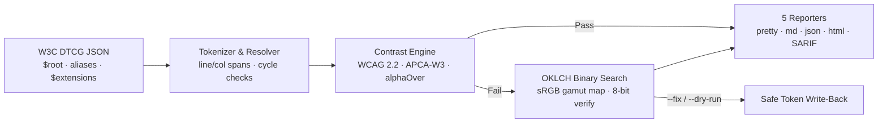
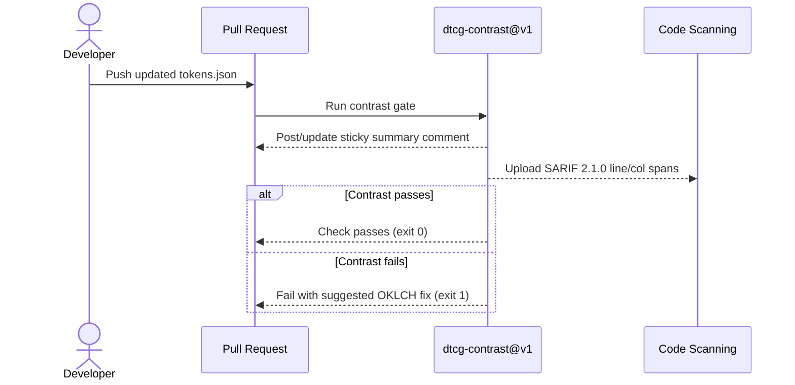

<a id="top"></a>

<div align="center">

<p><strong>English</strong> · <a href="./README.pt-br.md" lang="pt-BR">Português (PT-BR)</a></p>

<picture>
  <source media="(prefers-color-scheme: dark)" srcset="https://raw.githubusercontent.com/voaneves/dtcg-contrast/main/assets/logo/logo-dark.svg" />
  <source media="(prefers-color-scheme: light)" srcset="https://raw.githubusercontent.com/voaneves/dtcg-contrast/main/assets/logo/logo-light.svg" />
  
</picture>

<h1>dtcg-contrast</h1>

<p>
  <strong>Zero-dependency WCAG 2.2 &amp; APCA contrast gate and OKLCH auto-fixer for W3C DTCG 2025.10 design tokens.</strong><br />
  <sub>Shift contrast compliance left onto your token JSON — <kbd>check</kbd> · <kbd>init</kbd> · <kbd>--fix</kbd> · <kbd>--format=sarif</kbd></sub>
</p>

<p>
  <a href="#quick-start"><picture><source media="(prefers-color-scheme: dark)" srcset="https://raw.githubusercontent.com/voaneves/dtcg-contrast/main/assets/buttons/quick-start-en-dark.svg" /></picture></a>
  <a href="https://www.npmjs.com/package/dtcg-contrast"><picture><source media="(prefers-color-scheme: dark)" srcset="https://raw.githubusercontent.com/voaneves/dtcg-contrast/main/assets/buttons/npm-dark.svg" /></picture></a>
</p>

<p><sub>Need this in your design system? <a href="https://voaneves.com/en/#contact"><strong>Book an accessibility audit →</strong></a></sub></p>

<p>
  <a href="https://github.com/voaneves/dtcg-contrast/actions/workflows/ci.yml"></a>
  <a href="https://www.npmjs.com/package/dtcg-contrast"></a>
  <a href="./LICENSE"></a>
  
</p>

<p>
  <a href="#live-fix">Live OKLCH Fix</a> ·
  <a href="#quick-start">Quick Start</a> ·
  <a href="#architecture">Architecture</a> ·
  <a href="#cli-options">CLI</a> ·
  <a href="#github-action">GitHub Action</a> ·
  <a href="#api">JS / TS API</a> ·
  <a href="https://github.com/voaneves/dtcg-contrast/issues/new">Report Bug</a>
</p>

</div>

<picture>
  <source media="(prefers-color-scheme: dark)" srcset="https://raw.githubusercontent.com/voaneves/dtcg-contrast/main/assets/brand/rule-dark.svg" />
  <source media="(prefers-color-scheme: light)" srcset="https://raw.githubusercontent.com/voaneves/dtcg-contrast/main/assets/brand/rule-light.svg" />
  
</picture>

<a id="why-dtcg-contrast"></a>
## Why `dtcg-contrast`?

Checks that the text and background colors in your design-token JSON meet accessibility contrast requirements, and fixes the ones that don't.

> [!IMPORTANT]
> **Browser audits catch contrast bugs too late.** By the time Playwright, Lighthouse, or `axe-core` sees rendered DOM, broken tokens have already leaked into Figma libraries, component packages, and production CSS. `dtcg-contrast` validates **W3C DTCG 2025.10**[^1] JSON directly, in about 5 ms of audit time (≈100 ms including Node startup) with zero third-party packages — checking **WCAG 2.2**[^2], **APCA-W3**[^3], and computing hue-preserving **OKLCH**[^4] fixes at the source.

### Native W3C DTCG 2025.10

Parses `srgb`, `oklch`, `hsl`, `display-p3`, CSS `color(...)`, and `hex` fallbacks. Supports `$root` tokens, `$deprecated`, group `$type` inheritance, recursive directories, and multi-hop `{alias}` resolution with cycle detection.

### Multi-Theme &amp; Dual Standards

Evaluates `light`, `dark`, and high-contrast modes via nested or dotted `$extensions` (e.g., `vn.dark`, `com.figma.modes.dark`) or overlay files — computing exact **WCAG 2.2** ratios, **APCA-W3** `Lc`, and sRGB alpha compositing.

### Safe OKLCH Auto-Fixer

Binary-searches OKLCH lightness `L` while preserving hue `H` and gamut-mapped chroma `C`, then verifies the quantized 8-bit hex passes without rounding dips — writing safely to foreground tokens or `$extensions` without mutating shared primitives.

### Five built-in reporters

Outputs 24-bit ANSI swatches (`pretty`), Markdown for PR and Job Summaries (`markdown`), automation payloads (`json`), an interactive filterable Contrast Matrix (`html`), and **SARIF 2.1.0** with exact line/column PR diff spans. The GitHub Action builds on these with a sticky PR comment (`comment-pr`).

<a id="live-fix"></a>
## Live OKLCH Auto-Fix Showcase

Tested on [`examples/voaneves-brand/demo-fail.config.json`](./examples/voaneves-brand/demo-fail.config.json) (rendered natively — crisp on desktop and mobile):

| Pair | WCAG 2.2 | APCA Lc | Status |
| :--- | ---: | ---: | :--- |
| `light` · `color.text` on `color.surface` | **16.56:1** | `+93.8` | ✅ PASS (AAA) |
| `light` · `color.signal` on `color.surface` | ~~3.60:1~~ → **4.52:1** | `+54.6` → `+61.9` | ❌ FAIL → fix suggested: ~~#f50000~~ → #d70000 (ΔL −0.057) |
| `light` · `color.signal-ink` on `color.surface` | **5.78:1** | `+69.1` | ✅ PASS (AA) |
| `light` · `color.text-on-signal` on `color.surface-signal` | **4.60:1** | `+37.2` | ✅ PASS (AA) |
| `dark` · `color.text` on `color.surface` | **14.79:1** | `-86.8` | ✅ PASS (AAA) |
| `dark` · `color.signal-ink` on `color.surface` | **6.47:1** | `-45.2` | ✅ PASS (AA) |
| `dark` · `color.text-on-signal` on `color.surface-signal` | **5.54:1** | `+42.3` | ✅ PASS (AA) |

The diff below is the output of <kbd>npx dtcg-contrast</kbd> <kbd>--fix</kbd>: it updates only the offending semantic token while keeping `ref.color.red.600` (`#f50000` shared by `color.surface-signal`) untouched:

```diff
     "signal": {
-      "$value": "{ref.color.red.600}",
+      "$value": {
+        "colorSpace": "srgb",
+        "components": [0.8431, 0, 0],
+        "hex": "#d70000"
+      },
       "$extensions": { "vn": { "dark": "{ref.color.red.450}" } }
     },
```

> [!WARNING]
> **Always preview with <kbd>--dry-run</kbd> or inspect `git diff` before committing <kbd>--fix</kbd>:** when a failing semantic token aliases a shared primitive (`{ref.color.red.600}`), `--fix` deliberately unlinks only the foreground semantic token (`[unlinked alias]`) so shared backgrounds stay untouched.

<a id="quick-start"></a>
## Quick Start

```bash
# 1. Instant one-off color check (hex, rgb, hsl, oklch, or CSS color())
npx dtcg-contrast check "#f50000" "#f4ead4" --level=AA

# 2. Scaffold dtcg-contrast.config.json with $schema, detected themes & pairs
npx dtcg-contrast init ./tokens

# 3. Preview and write OKLCH fixes safely back to failing tokens
npx dtcg-contrast --config=dtcg-contrast.config.json --fix --dry-run
npx dtcg-contrast --config=dtcg-contrast.config.json --fix

# 4. Run the included production showcase (@voaneves/brand tokens) (from a git clone)
npx dtcg-contrast --config examples/voaneves-brand/dtcg-contrast.config.json
```

### Explicit Config with `$schema`, Globs &amp; Exclusions

> [!TIP]
> Point `"$schema"` to [`dtcg-contrast.schema.json`](./dtcg-contrast.schema.json) (shipped in the [npm package][npm] and on GitHub) for instant VS Code / JetBrains autocomplete and validation.

```json
{
  "$schema": "https://raw.githubusercontent.com/voaneves/dtcg-contrast/main/dtcg-contrast.schema.json",
  "tokens": ["./tokens.json"],
  "themes": [
    { "name": "light" },
    { "name": "dark", "extensionPath": "vn.dark" }
  ],
  "pairs": [
    {
      "fg": "color.text*",
      "bg": "color.surface*",
      "exclude": ["*-inverse", "*-signal"],
      "level": "AA"
    },
    { "fg": "color.signal-ink", "bg": "color.surface", "level": "AA" },
    { "fg": "color.line-strong", "bg": "color.surface", "level": "UI" }
  ]
}
```

<a id="architecture"></a>
## Architecture &amp; Standards Matrix



*Flow: DTCG JSON is tokenized and resolved, contrast is computed, failures get an OKLCH fix, and every result goes to the reporters.*

| Capability | `dtcg-contrast` | Browser audits (`axe` / Lighthouse) | Manual Figma plugins |
| :--- | :--- | :--- | :--- |
| Runs at token source | ✅ Pre-CSS, 0 deps | ❌ Needs built app + browser | ❌ Manual per frame |
| W3C DTCG 2025.10 (`$root`, `{alias}`, `$extensions`) | ✅ Native | ❌ Sees only compiled CSS | ⚠️ Varies by plugin |
| Dual WCAG 2.2 + APCA-W3 + alpha compositing | ✅ Built-in | ⚠️ WCAG only | ⚠️ Often partial |
| Hue-preserving OKLCH `--fix` write-back | ✅ Hex-verified | ❌ Reports failures only | ❌ Manual tweaking |
| CI outputs (SARIF 2.1.0 spans, PR comments, HTML) | ✅ Built-in | ⚠️ Custom wiring | ❌ No CI gate |

<details>
  <summary><strong>Standards checklist</strong></summary>

  - [x] **W3C DTCG 2025.10**[^1] color module (`srgb`, `oklch`, `hsl`, `display-p3`, `$root`, `$deprecated`, `{alias}`, `$extensions`)
  - [x] **WCAG 2.2**[^2] relative luminance &amp; thresholds (`AA` 4.5:1, `AA-large` / `UI` 3.0:1, `AAA` 7.0:1)
  - [x] **APCA-W3**[^3] (`0.0.98G-4g`) perceptual `Lc` polarity &amp; soft clamp
  - [x] **SARIF 2.1.0** `physicalLocation.region` (`startLine`, `startColumn`) for GitHub Code Scanning

</details>

<a id="cli-options"></a>
## CLI Options

Supports both `--flag value` and `--flag=value`.

| Flag / Subcommand | Description | Default |
| :--- | :--- | :--- |
| `[paths...]` | DTCG `.json` token files or directories (zero-config mode) | — |
| `check <fg> <bg>` | Check two CSS/hex/OKLCH colors directly | — |
| `init <paths...>` | Scaffold `dtcg-contrast.config.json` from tokens | — |
| `-c, --config <file>` | Config JSON path (auto-detects `./dtcg-contrast.config.json`) | — |
| `-f, --format <fmt>` | Output: `pretty`, `markdown`, `json`, `html`, `sarif` | `pretty` |
| `-o, --output <file>` | Write formatted report or `init` config to file | stdout |
| `--level <level>` | Threshold: `AA`, `AA-large`, `UI`, `AAA`, `AAA-large` | smart (`AA`/`UI`) |
| `--min-apca <num>` | Minimum APCA `\|Lc\|` threshold across evaluated pairs | `0` |
| `--mode <name:path>` | Add theme from `$extensions.<path>` (supports dotted keys) | `default` |
| `--fix` | Write OKLCH fixes back to failing foreground tokens | `false` |
| `--dry-run` | Preview `--fix` edits without modifying files | `false` |
| `--force` | Overwrite existing config file during `init` | `false` |
| `--no-fail` | Exit `0` even when pairs fail (advisory reports) | `false` |
| `--no-color` | Disable 24-bit ANSI swatches | `false` |

<dl>
  <dt><strong>Exit Codes</strong></dt>
  <dd><code>0</code> — all evaluated pairs pass (or <code>--no-fail</code> set) · <code>1</code> — one or more contrast failures · <code>2</code> — invalid CLI usage, config, or token error.</dd>
  <dt><strong>WCAG 2.2 Presets</strong></dt>
  <dd><code>AA</code> = 4.5:1 (body text) · <code>AA-large</code> = 3.0:1 (18pt / 14pt bold) · <code>UI</code> = 3.0:1 (borders, icons, focus rings) · <code>AAA</code> = 7.0:1 · <code>AAA-large</code> = 4.5:1.</dd>
</dl>

<a id="github-action"></a>
## GitHub Action, Sticky PR Comments &amp; SARIF

Gate pull requests with a sticky PR comment (`<!-- dtcg-contrast -->`), Markdown Job Summary, interactive HTML Contrast Matrix, and exact line/column PR diff annotations via SARIF 2.1.0:



```yaml
permissions:
  contents: read
  pull-requests: write   # sticky PR comment
  security-events: write # SARIF upload

steps:
  - uses: actions/checkout@v5
  - name: Design token contrast gate
    uses: voaneves/dtcg-contrast@v1
    with:
      config: dtcg-contrast.config.json
      comment-pr: 'true'
      html-report: contrast-matrix.html
      sarif-report: contrast.sarif
  - name: Upload SARIF to GitHub Code Scanning
    if: always()
    uses: github/codeql-action/upload-sarif@v4
    with:
      sarif_file: contrast.sarif
```

> [!NOTE]
> PR comments are skipped on pull requests from forks (the token is read-only). Set `fail-on-error: 'false'` to make the gate advisory instead of failing the step.

<details>
  <summary><strong>All Action Inputs &amp; Outputs</strong></summary>

  | Input | Default | Description |
  | :--- | :--- | :--- |
  | `config` | `''` | Path to `dtcg-contrast.config.json` |
  | `tokens` | `''` | Space-separated paths for zero-config mode |
  | `modes` | `''` | Space-separated `name:extensionPath` themes (e.g., `dark:vn.dark`) |
  | `level` | `''` | Override default WCAG threshold |
  | `min-apca` | `''` | Minimum APCA `\|Lc\|` score |
  | `fail-on-error` | `'true'` | Fail workflow step when pairs fail |
  | `html-report` | `''` | Output path for standalone interactive HTML matrix |
  | `sarif-report` | `''` | Output path for SARIF 2.1.0 report |
  | `summary` | `'true'` | Append Markdown table to `$GITHUB_STEP_SUMMARY` |
  | `comment-pr` | `'false'` | Post or update a sticky contrast comment on pull requests |
  | `token` | `${{ github.token }}` | Token used when `comment-pr` is `'true'` |

  **Outputs:** `total`, `passed`, `failed`.

</details>

<a id="api"></a>
## Programmatic JS / TS API

Zero runtime dependencies — works directly in Node `>=22` ESM and TypeScript projects (ships full [`types/index.d.ts`](./types/index.d.ts)):

```js
import {
  loadTokenSources,
  detectExtensionPaths,
  evaluatePairs,
  planFixes,
  applyFixes,
} from 'dtcg-contrast';

const tokenTree = loadTokenSources('./tokens');
const themes = [
  { name: 'light' },
  ...detectExtensionPaths(tokenTree).map((m) => ({ name: m, extensionPath: m })),
];

const report = evaluatePairs({ tokenTree, themes });
if (report.summary.failed > 0) {
  const { edits } = planFixes({ report, tokenTree, themes });
  applyFixes(edits, { dryRun: true });
}
```

<details>
  <summary><strong>Under the Hood: WCAG 2.2 &amp; OKLCH Math</strong></summary>

  `dtcg-contrast` composites semi-transparent foregrounds via Porter-Duff `source-over` in sRGB, computes WCAG 2.x relative luminance and contrast ratio, and binary-searches OKLCH lightness `L` at fixed hue `H` with sRGB chroma gamut mapping:

  $$L_{\text{rel}} = 0.2126 \cdot R_{\text{lin}} + 0.7152 \cdot G_{\text{lin}} + 0.0722 \cdot B_{\text{lin}}$$

  $$\text{CR} = \frac{\max(L_1, L_2) + 0.05}{\min(L_1, L_2) + 0.05} \in [1, 21]$$

  After quantization to 8-bit hex, the candidate is re-parsed and checked against both the requested WCAG ratio and APCA-W3 `Lc` threshold before being emitted.

</details>

<a id="consulting"></a>
## Case study & consulting

Built alongside [`@voaneves/brand`][brand] — Victor Neves' production W3C DTCG 2025.10 design system powering [`voaneves.com`][site] with zero runtime dependencies and automated WCAG 2.2 AA gates.

### This README gates itself

The logo and buttons on this page are generated from DTCG tokens in `examples/readme-assets/`, and every color pair is checked by dtcg-contrast in CI on each push.

| Element | Light (on `#ffffff`) | Dark (on `#0d1117`) |
| :--- | ---: | ---: |
| Primary button text | **16.56:1** | **14.79:1** |
| Primary button signal dot | **5.54:1** | **5.16:1** |
| Secondary button text | **16.56:1** | **12.97:1** |
| `$` prompt on the npm button | **5.78:1** | **5.67:1** |
| Button edge vs. page | **19.80:1** | **4.91:1** |
| Logo signal on paper / ink | **4.52:1** / **3.67:1** | **4.52:1** / **3.67:1** |
| Logo ring vs. page | **19.80:1** | **14.14:1** |

✅ **20 / 20 pairs pass** (WCAG 2.2 AA for text, 3:1 for UI) — reproduce with <kbd>npm run readme:check</kbd> or see [`examples/readme-assets/`](./examples/readme-assets/). The dark-mode button fill was tuned from `#0a0a0a` to `#1c1a17` by this gate, and the logo's red dot is `#d70000`: the exact color `--fix` produces in the showcase above.

- **W3C DTCG Design System Architecture** — Multi-brand and light/dark token pipelines synced cleanly from Figma to CSS, Astro, React, iOS, and Android.
- **WCAG 2.2 AA / EAA Accessibility Audits** — Comprehensive technical audits covering color contrast, APCA perceptual legibility, focus management, and semantic UI.
- **Automated CI/CD &amp; GitOps Quality Gates** — Turnkey Lighthouse CI, Playwright, axe-core, and token-governance gates that block regressions before merge.

<p align="center">
  <a href="https://voaneves.com/en/#contact"><picture><source media="(prefers-color-scheme: dark)" srcset="https://raw.githubusercontent.com/voaneves/dtcg-contrast/main/assets/buttons/audit-en-dark.svg" /></picture></a>
  <a href="https://voaneves.com/en/"><picture><source media="(prefers-color-scheme: dark)" srcset="https://raw.githubusercontent.com/voaneves/dtcg-contrast/main/assets/buttons/site-dark.svg" /></picture></a>
</p>

<p align="center">
  <strong>Serving Brazil &amp; Worldwide (Remote / Hybrid)</strong><br />
  <a href="https://www.linkedin.com/in/voaneves/"><strong>💼 LinkedIn</strong></a> ·
  <a href="mailto:victorneves478@gmail.com"><strong>✉️ E-mail</strong></a>
</p>

<div align="center">
  <a href="https://voaneves.com/en/">
    <picture>
      <source media="(prefers-color-scheme: dark)" srcset="https://raw.githubusercontent.com/voaneves/dtcg-contrast/main/assets/brand/mark-dark.svg" />
      <source media="(prefers-color-scheme: light)" srcset="https://raw.githubusercontent.com/voaneves/dtcg-contrast/main/assets/brand/mark-light.svg" />
      
    </picture>
  </a>
  <br />
  <sub><a href="./LICENSE">MIT License</a> © 2026 <a href="https://github.com/voaneves">Victor Neves</a> · <strong>VOANEVES.</strong> Signal, not noise.</sub>
</div>

<p align="right"><a href="#top">↑ Back to top</a></p>

[^1]: **W3C Design Tokens Format Module 2025.10** — [tr.designtokens.org/format](https://tr.designtokens.org/format/)
[^2]: **W3C WCAG 2.2 Contrast (Minimum &amp; Non-text)** — [w3.org/TR/WCAG22](https://www.w3.org/TR/WCAG22/#contrast-minimum)
[^3]: **APCA-W3 (`0.0.98G-4g`) Perceptual Contrast** — [git.apcacontrast.com](https://git.apcacontrast.com/)
[^4]: **Björn Ottosson — Oklab / OKLCH Perceptual Color Space** — [bottosson.github.io/posts/oklab](https://bottosson.github.io/posts/oklab/)

[npm]: https://www.npmjs.com/package/dtcg-contrast
[brand]: https://github.com/voaneves/brand
[site]: https://voaneves.com/en/
