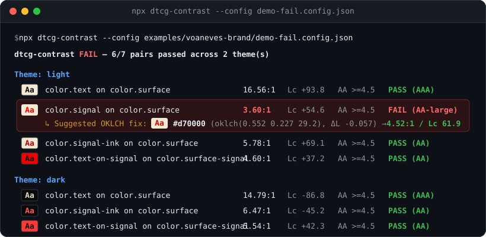

<div align="center">

<p>🇺🇸 <strong>English</strong> · <a href="./README.pt-br.md">🇧🇷 Versão em Português (PT-BR)</a></p>

# dtcg-contrast

**Zero-dependency WCAG 2.2 &amp; APCA contrast gate and OKLCH auto-fixer for W3C DTCG 2025.10 design tokens.**

<p>
  <a href="./LICENSE"></a>
  =20" />
  
  
  
</p>



</div>

## Why `dtcg-contrast`?

Most accessibility tooling audits **after** CSS compilation or browser rendering—long after broken token values have shipped to Figma, components, and docs. `dtcg-contrast` shifts compliance left directly onto your **W3C Design Tokens Community Group (DTCG) 2025.10** JSON source in ~15ms with zero npm dependencies:

- **Native W3C DTCG 2025.10 parser** — supports `srgb`, `oklch`, `hsl`, `display-p3`, `hex` fallback, group `$type` inheritance, recursive folders, and multi-hop `{alias}` resolution (with cycle detection).
- **Multi-theme ready** — evaluate `light`, `dark`, and high-contrast modes from `$extensions` paths (e.g., `vn.dark` / `mode.dark`) or overlay JSON files.
- **Dual perceptual standards** — exact **WCAG 2.2** contrast ratio (`AA`, `AA-large`, `UI`, `AAA`, `AAA-large`) + **APCA-W3** (`0.0.98G-4g`) `Lc` scoring with alpha compositing.
- **Hue-preserving OKLCH auto-fixer** — when a pair fails, binary-searches OKLCH lightness `L` (preserving hue `H` and gamut-mapped chroma `C`) and verifies the quantized 8-bit `#rrggbb` hex passes without rounding regressions.
- **Four outputs + Composite GitHub Action** — 24-bit ANSI terminal swatches (`pretty`), GitHub Job Summary (`markdown`), CI automation (`json`), and a standalone interactive Contrast Matrix (`html`).

---

## Quick Start

### Zero-config mode (auto-discovers semantic & component pairs)

```bash
npx dtcg-contrast ./tokens --mode dark:vn.dark
```

### Explicit CI gate (`dtcg-contrast.config.json`)

```json
{
  "tokens": ["./tokens.json"],
  "themes": [
    { "name": "light" },
    { "name": "dark", "extensionPath": "vn.dark" }
  ],
  "pairs": [
    { "fg": "color.text", "bg": "color.surface", "level": "AA" },
    { "fg": "color.signal-ink", "bg": "color.surface", "level": "AA" },
    { "fg": "color.line-strong", "bg": "color.surface", "level": "UI" }
  ]
}
```

Run the included production showcase (built from [`@voaneves/brand`](https://github.com/voaneves/brand)):

```bash
npx dtcg-contrast --config examples/voaneves-brand/dtcg-contrast.config.json
# Or see the OKLCH auto-fixer catch a failing pair:
npx dtcg-contrast --config examples/voaneves-brand/demo-fail.config.json
```

---

## CLI Options

| Flag | Description | Default |
| :--- | :--- | :--- |
| `[paths...]` | DTCG token `.json` files or directories | — |
| `-c, --config <file>` | Config JSON path (auto-detects `dtcg-contrast.config.json`) | — |
| `-f, --format <fmt>` | Output format: `pretty`, `markdown`, `json`, `html` | `pretty` |
| `-o, --output <file>` | Write formatted report to file | stdout |
| `--level <level>` | Threshold for auto-discovered pairs: `AA`, `AA-large`, `UI`, `AAA`, `AAA-large` | smart (`AA`/`UI`) |
| `--min-apca <num>` | Require minimum APCA `\|Lc\|` across evaluated pairs | `0` |
| `--mode <name:path>` | Add a theme from `$extensions.<path>` (repeatable, e.g. `dark:vn.dark`) | `default` |
| `--no-fail` | Exit `0` even when pairs fail (advisory reports) | `false` |
| `--no-color` | Disable 24-bit ANSI swatch output | `false` |

Exit codes: `0` all pass, `1` one or more contrast failures, `2` invalid config/tokens/CLI usage.

---

## GitHub Action

Gate pull requests in 8 lines with an automatic Markdown report in `$GITHUB_STEP_SUMMARY` and an optional downloadable HTML Contrast Matrix:

```yaml
- name: Design Token Contrast Gate
  uses: voaneves/dtcg-contrast@v0.1.0
  with:
    config: dtcg-contrast.config.json
    html-report: contrast-matrix.html
```

<details>
<summary>All Action inputs & outputs</summary>

| Input | Default | Description |
| :--- | :--- | :--- |
| `config` | `''` | Path to `dtcg-contrast.config.json` |
| `tokens` | `''` | Space-separated paths for zero-config mode |
| `level` | `''` | Override default WCAG threshold |
| `min-apca` | `''` | Minimum APCA `\|Lc\|` score |
| `fail-on-error` | `'true'` | Fail workflow step when pairs fail |
| `html-report` | `''` | Optional output path for standalone HTML matrix |
| `summary` | `'true'` | Append Markdown table to `$GITHUB_STEP_SUMMARY` |

Outputs: `total`, `passed`, `failed`.

</details>

---

## Programmatic JS / TS API

Zero runtime dependencies — works directly in Node `>=20` ESM and TypeScript projects (ships full [`types/index.d.ts`](./types/index.d.ts)):

```js
import {
  loadTokenSources,
  evaluatePairs,
  suggestAccessibleColor,
  wcagContrast,
  apcaContrast,
} from 'dtcg-contrast';

const tree = loadTokenSources('./tokens');
const report = evaluatePairs({
  tokenTree: tree,
  themes: [{ name: 'light' }, { name: 'dark', extensionPath: 'vn.dark' }],
});

if (report.summary.failed > 0) {
  console.log(suggestAccessibleColor('#f50000', '#f4ead4', { minWcag: 4.5 }));
  // -> { hex: '#d70000', oklch: 'oklch(0.552 0.227 29.2)', wcag: 4.52, apca: 61.9, deltaL: -0.057 }
}
```

---

## Live Production Case Study

Built alongside [`@voaneves/brand`](https://github.com/voaneves/brand) — Victor Neves' production W3C DTCG 2025.10 design system powering [`voaneves.com`](https://voaneves.com/en/) with zero runtime dependencies and automated WCAG 2.2 AA gates.

---

## Commercial Support, Audits & Consulting

Need a W3C DTCG design system, **WCAG 2.2 AA / EAA accessibility audit**, or automated CI/GitOps quality gates (Lighthouse CI, Playwright, axe-core, token governance) for your team?

- 🌐 **Portfolio & Consulting:** [voaneves.com/en/](https://voaneves.com/en/)
- 💼 **LinkedIn:** [linkedin.com/in/voaneves](https://www.linkedin.com/in/voaneves/)
- 💖 **Sponsor ongoing OSS work:** [github.com/sponsors/voaneves](https://github.com/sponsors/voaneves)

---

## License

[MIT](./LICENSE) © 2026 [Victor Neves](https://github.com/voaneves)
