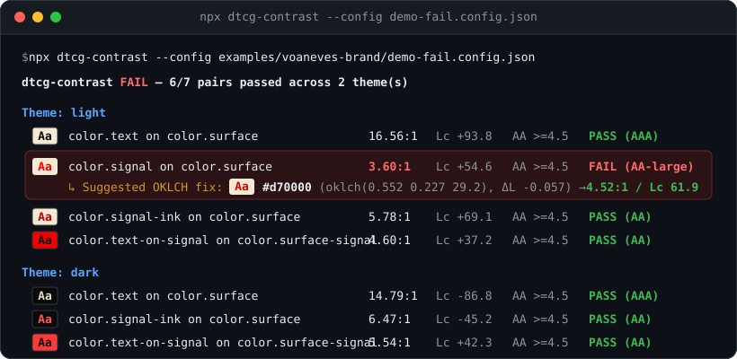

<div align="center">

<p><a href="./README.md">🇺🇸 English</a> · 🇧🇷 <strong>Português (PT-BR)</strong></p>

# dtcg-contrast

**Quality gate de contraste WCAG 2.2 &amp; APCA e corretor automático em OKLCH para design tokens W3C DTCG 2025.10 — zero dependências.**

<p>
  <a href="./LICENSE"></a>
  =20" />
  
  
</p>



</div>

## Por que usar o `dtcg-contrast`?

A maioria das auditorias de acessibilidade acontece **tarde demais** — depois que o CSS foi compilado ou o app já está no browser. O `dtcg-contrast` valida diretamente a fonte JSON no padrão **W3C Design Tokens Community Group (DTCG) 2025.10** em ~15ms, sem nenhuma dependência externa:

- **Parser nativo W3C DTCG 2025.10** — suporta `srgb`, `oklch`, `hsl`, `display-p3`, fallback `hex`, herança de `$type`, diretórios recursivos e aliases `{caminho.do.token}` em múltiplos saltos.
- **Multi-tema integrado** — avalia modos `light`, `dark` e alto contraste via `$extensions` (ex.: `vn.dark` / `mode.dark`) ou arquivos overlay.
- **WCAG 2.2 + APCA-W3** — calcula razão WCAG (`AA`, `AA-large`, `UI`, `AAA`) e escore perceptual APCA `Lc` com composição alpha automática.
- **Correção inteligente em OKLCH** — para cada par reprovado, busca o ajuste mínimo de luminosidade `L` preservando matiz `H` e croma `C` no gamut sRGB, garantindo aprovação já no `#rrggbb` final.
- **4 formatos + GitHub Action pronta** — terminal ANSI 24-bit (`pretty`), resumo no PR (`markdown`), CI (`json`) e matriz visual interativa em arquivo único (`html`).

## Uso Rápido

```bash
# Modo zero-config (descobre pares semânticos e de UI automaticamente)
npx dtcg-contrast ./tokens --mode dark:vn.dark

# Com arquivo de configuração (exemplo do @voaneves/brand)
npx dtcg-contrast --config examples/voaneves-brand/dtcg-contrast.config.json

# Demo capturando falha e sugerindo correção exata em OKLCH
npx dtcg-contrast --config examples/voaneves-brand/demo-fail.config.json
```

### GitHub Action

```yaml
- name: Gate de Contraste nos Design Tokens
  uses: voaneves/dtcg-contrast@v0.1.0
  with:
    config: dtcg-contrast.config.json
    html-report: contrast-matrix.html
```

Consulte o [README em inglês](./README.md) para a referência completa de CLI, inputs/outputs da Action e API JavaScript/TypeScript.

---

## Consultoria, Auditoria de Acessibilidade & Design Systems

Precisa estruturar um Design System no padrão **W3C DTCG**, adequar produtos à **WCAG 2.2 AA / LBI** ou implantar pipelines automatizados de qualidade (Lighthouse CI, Playwright, GitOps)?

- 🌐 **Portfólio e Contato:** [voaneves.com](https://voaneves.com/)
- 💼 **LinkedIn:** [linkedin.com/in/voaneves](https://www.linkedin.com/in/voaneves/)
- 💖 **Apoie no GitHub Sponsors:** [github.com/sponsors/voaneves](https://github.com/sponsors/voaneves)

---

## Licença

[MIT](./LICENSE) © 2026 [Victor Neves](https://github.com/voaneves)
