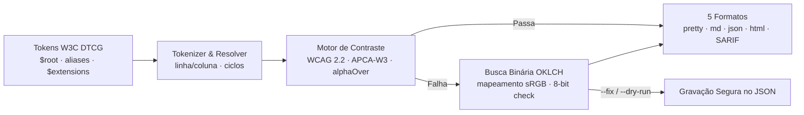

<a id="top"></a>

<div align="center">

<p><a href="./README.md">🇺🇸 English</a> · 🇧🇷 <strong>Português (PT-BR)</strong></p>

<picture>
  <source media="(prefers-color-scheme: dark)" srcset="https://raw.githubusercontent.com/voaneves/dtcg-contrast/main/assets/brand/mark-dark.svg" />
  <source media="(prefers-color-scheme: light)" srcset="https://raw.githubusercontent.com/voaneves/dtcg-contrast/main/assets/brand/mark-light.svg" />
  
</picture>

<h1>dtcg-contrast</h1>

<p>
  <strong>Quality gate de contraste WCAG 2.2 &amp; APCA e corretor automático em OKLCH para design tokens W3C DTCG 2025.10 — zero dependências.</strong><br />
  <sub>Valide o JSON de tokens em ~15ms antes mesmo de compilar CSS — CLI, API JS/TS e GitHub Action.</sub>
</p>

<p>
  <a href="https://github.com/voaneves/dtcg-contrast/actions/workflows/ci.yml"></a>
  <a href="https://www.npmjs.com/package/dtcg-contrast"></a>
  <a href="https://www.npmjs.com/package/dtcg-contrast"></a>
  <a href="./LICENSE"></a>
  =22" />
  
  
</p>

<p>
  <a href="#por-que-usar">Visão Geral</a> ·
  <a href="#correcao-oklch">Correção OKLCH</a> ·
  <a href="#uso-rapido">Uso Rápido</a> ·
  <a href="#github-action">GitHub Action</a> ·
  <a href="#consultoria">Consultoria</a> ·
  <a href="./README.md">Docs Completas (EN)</a>
</p>

</div>

<details>
  <summary><strong>Índice</strong> — guia rápido</summary>
  <ol>
    <li><a href="#por-que-usar">Por que usar o <code>dtcg-contrast</code>?</a></li>
    <li><a href="#correcao-oklch">Demonstração ao vivo de correção OKLCH</a></li>
    <li><a href="#arquitetura">Arquitetura e Conformidade</a></li>
    <li><a href="#uso-rapido">Uso Rápido (<code>check</code>, <code>init</code>, <code>--fix</code>)</a></li>
    <li><a href="#github-action">GitHub Action + Comentário no PR + SARIF</a></li>
    <li><a href="#consultoria">Consultoria, Auditoria &amp; Licença</a></li>
  </ol>
</details>

<picture>
  <source media="(prefers-color-scheme: dark)" srcset="https://raw.githubusercontent.com/voaneves/dtcg-contrast/main/assets/brand/rule-dark.svg" />
  <source media="(prefers-color-scheme: light)" srcset="https://raw.githubusercontent.com/voaneves/dtcg-contrast/main/assets/brand/rule-light.svg" />
  
</picture>

<a id="por-que-usar"></a>
## ⚡ Por que usar o `dtcg-contrast`?

> [!IMPORTANT]
> **Auditorias no browser pegam falhas tarde demais.** Quando o Lighthouse ou o `axe-core` analisa o HTML, os tokens inválidos já vazaram para o Figma, bibliotecas de UI e CSS em produção. O `dtcg-contrast` valida diretamente a fonte JSON **W3C DTCG 2025.10** em ~15ms, sem nenhuma dependência externa.

<table>
  <tr>
    <td width="50%" valign="top">
      <h3>🧩 Parser Nativo W3C DTCG 2025.10</h3>
      <p>Suporta <code>srgb</code>, <code>oklch</code>, <code>hsl</code>, <code>display-p3</code>, CSS <code>color(...)</code> e fallback <code>hex</code>, além de <code>$root</code>, <code>$deprecated</code>, herança de <code>$type</code>, diretórios recursivos e aliases <code>{caminho.do.token}</code>.</p>
    </td>
    <td width="50%" valign="top">
      <h3>🌓 Multi-tema &amp; WCAG 2.2 + APCA</h3>
      <p>Avalia modos via <code>$extensions</code> aninhadas ou com pontos (ex.: <code>vn.dark</code>, <code>com.figma.modes.dark</code>) ou overlay, calculando razão <strong>WCAG 2.2</strong>, escore perceptual <strong>APCA-W3</strong> <code>Lc</code> e composição alpha.</p>
    </td>
  </tr>
  <tr>
    <td width="50%" valign="top">
      <h3>🎯 Corretor Seguro em OKLCH</h3>
      <p>Ajusta a luminosidade <code>L</code> por busca binária preservando matiz <code>H</code> e croma <code>C</code> no gamut sRGB, validando no <code>#rrggbb</code> final — gravando direto no token de foreground sem alterar primitivos compartilhados.</p>
    </td>
    <td width="50%" valign="top">
      <h3>📊 Cinco Relatórios para CI/PR</h3>
      <p>Entrega terminal ANSI 24-bit (<code>pretty</code>), resumo e comentário fixo em PR (<code>markdown</code> / <code>comment-pr</code>), JSON, matriz interativa em HTML único e <strong>SARIF 2.1.0</strong> com linha e coluna exatas.</p>
    </td>
  </tr>
</table>

<a id="correcao-oklch"></a>
## 🎨 Demonstração ao Vivo de Correção OKLCH

Resultado real em [`examples/voaneves-brand/demo-fail.config.json`](./examples/voaneves-brand/demo-fail.config.json) (legível tanto no desktop quanto no celular):

| Tema | Par de Tokens | Foreground | Background | WCAG 2.2 | APCA `Lc` | Status &amp; Correção OKLCH |
| :--- | :--- | :--- | :--- | ---: | ---: | :--- |
| `light` | `color.text` em `color.surface` | `#0a0a0a` | `#f4ead4` | **16.56:1** | `+93.8` | ✅ `PASS (AAA)` |
| `light` | `color.signal` em `color.surface` | `#f50000` | `#f4ead4` | **3.60:1** | `+54.6` | ❌ `FAIL` → **`#d70000`** (`ΔL -0.057`, **4.52:1**) |
| `light` | `color.signal-ink` em `color.surface` | `#b80000` | `#f4ead4` | **5.78:1** | `+69.1` | ✅ `PASS (AA)` |
| `light` | `color.text-on-signal` em `color.surface-signal` | `#0a0a0a` | `#f50000` | **4.60:1** | `+37.2` | ✅ `PASS (AA)` |
| `dark` | `color.text` em `color.surface` | `#e8dec5` | `#0a0a0a` | **14.79:1** | `-86.8` | ✅ `PASS (AAA)` |
| `dark` | `color.signal-ink` em `color.surface` | `#ff5a5a` | `#0a0a0a` | **6.47:1** | `-45.2` | ✅ `PASS (AA)` |
| `dark` | `color.text-on-signal` em `color.surface-signal` | `#0a0a0a` | `#ff3838` | **5.54:1** | `+42.3` | ✅ `PASS (AA)` |

Ao rodar `npx dtcg-contrast --config=examples/voaneves-brand/demo-fail.config.json --fix`, apenas o token semântico reprovado é ajustado (preservando `ref.color.red.600` intacto):

```diff
     "signal": {
-      "$value": "{ref.color.red.600}",
+      "$value": {
+        "colorSpace": "srgb",
+        "components": [0.8431, 0, 0],
+        "hex": "#d70000"
+      },
       "$extensions": { "vn": { "dark": "{ref.color.red.450}" } }
     },
```

<a id="arquitetura"></a>
## 🧭 Arquitetura



<picture>
  <source media="(prefers-color-scheme: dark)" srcset="https://raw.githubusercontent.com/voaneves/dtcg-contrast/main/assets/brand/rule-dark.svg" />
  <source media="(prefers-color-scheme: light)" srcset="https://raw.githubusercontent.com/voaneves/dtcg-contrast/main/assets/brand/rule-light.svg" />
  
</picture>

<a id="uso-rapido"></a>
## 🚀 Uso Rápido

```bash
# Testar duas cores na hora pelo terminal
npx dtcg-contrast check "#f50000" "#f4ead4" --level=AA

# Gerar dtcg-contrast.config.json com $schema, temas e pares descobertos automaticamente
npx dtcg-contrast init ./tokens

# Simular e gravar correções OKLCH nos tokens reprovados
npx dtcg-contrast --config=dtcg-contrast.config.json --fix --dry-run
npx dtcg-contrast --config=dtcg-contrast.config.json --fix

# Showcase oficial do @voaneves/brand
npx dtcg-contrast --config examples/voaneves-brand/dtcg-contrast.config.json
```

<a id="github-action"></a>
## 🤖 GitHub Action + Comentário no PR + SARIF

```yaml
- name: Gate de Contraste nos Design Tokens
  uses: voaneves/dtcg-contrast@v1
  with:
    config: dtcg-contrast.config.json
    comment-pr: 'true'
    html-report: contrast-matrix.html
    sarif-report: contrast.sarif
    fail-on-error: 'false'

- name: Enviar SARIF para GitHub Code Scanning
  if: always()
  uses: github/codeql-action/upload-sarif@v4
  with:
    sarif_file: contrast.sarif
```

Consulte o [README em inglês](./README.md) para a referência completa de CLI, todos os inputs/outputs da Action, fórmula matemática em KaTeX e API JavaScript/TypeScript.

<picture>
  <source media="(prefers-color-scheme: dark)" srcset="https://raw.githubusercontent.com/voaneves/dtcg-contrast/main/assets/brand/rule-dark.svg" />
  <source media="(prefers-color-scheme: light)" srcset="https://raw.githubusercontent.com/voaneves/dtcg-contrast/main/assets/brand/rule-light.svg" />
  
</picture>

<a id="consultoria"></a>
## 🤝 Estudo de Caso &amp; Consultoria

Construído em conjunto com [`@voaneves/brand`](https://github.com/voaneves/brand) — o design system em produção do [`voaneves.com`](https://voaneves.com) com zero dependências de runtime.

<table>
  <tr>
    <td width="60%" valign="top">
      <h3>Design Systems, Acessibilidade &amp; Quality Gates</h3>
      <ul>
        <li><strong>Design Systems W3C DTCG:</strong> Pipelines multi-tema de tokens integrados do Figma ao código</li>
        <li><strong>Conformidade WCAG 2.2 AA / LBI / EAA:</strong> Auditoria técnica completa de contraste, foco e semântica</li>
        <li><strong>Quality Gates em CI/GitOps:</strong> Lighthouse CI, Playwright, axe-core e governança automatizada</li>
      </ul>
    </td>
    <td width="40%" valign="middle" align="center">
      <p><strong>Brasil e exterior · Remoto ou híbrido</strong></p>
      <p>
        <a href="https://voaneves.com"><strong>🌐 voaneves.com</strong></a><br />
        <a href="https://www.linkedin.com/in/voaneves/"><strong>💼 LinkedIn</strong></a> ·
        <a href="mailto:victorneves478@gmail.com"><strong>✉️ E-mail</strong></a><br />
        <a href="https://github.com/sponsors/voaneves"><strong>💖 GitHub Sponsors</strong></a>
      </p>
    </td>
  </tr>
</table>

<div align="center">
  <a href="https://voaneves.com">
    <picture>
      <source media="(prefers-color-scheme: dark)" srcset="https://raw.githubusercontent.com/voaneves/dtcg-contrast/main/assets/brand/mark-dark.svg" />
      <source media="(prefers-color-scheme: light)" srcset="https://raw.githubusercontent.com/voaneves/dtcg-contrast/main/assets/brand/mark-light.svg" />
      
    </picture>
  </a>
  <br />
  <sub><a href="./LICENSE">Licença MIT</a> © 2026 <a href="https://github.com/voaneves">Victor Neves</a> · <strong>VOANEVES.</strong> Sinal, não ruído.</sub>
</div>

<p align="right"><a href="#top">↑ Voltar ao topo</a></p>
