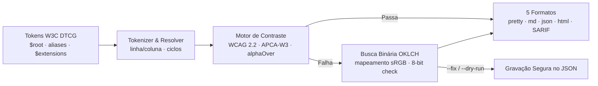
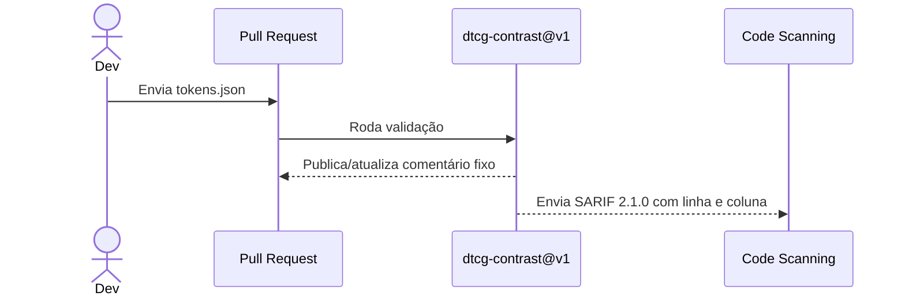

<a id="top"></a>

<div align="center">

<p><a href="./README.md" lang="en">English</a> · <strong>Português (PT-BR)</strong></p>

<picture>
  <source media="(prefers-color-scheme: dark)" srcset="https://raw.githubusercontent.com/voaneves/dtcg-contrast/main/assets/logo/logo-dark.svg" />
  <source media="(prefers-color-scheme: light)" srcset="https://raw.githubusercontent.com/voaneves/dtcg-contrast/main/assets/logo/logo-light.svg" />
  
</picture>

<h1>dtcg-contrast</h1>

<p>
  <strong>Quality gate de contraste WCAG 2.2 &amp; APCA e corretor automático em OKLCH para design tokens W3C DTCG 2025.10 — zero dependências.</strong><br />
  <sub>Valide o JSON de tokens antes mesmo de compilar CSS — <kbd>check</kbd> · <kbd>init</kbd> · <kbd>--fix</kbd> · <kbd>--format=sarif</kbd></sub>
</p>

<p>
  <a href="#uso-rapido"><picture><source media="(prefers-color-scheme: dark)" srcset="https://raw.githubusercontent.com/voaneves/dtcg-contrast/main/assets/buttons/quick-start-pt-dark.svg" /></picture></a>
  <a href="https://www.npmjs.com/package/dtcg-contrast"><picture><source media="(prefers-color-scheme: dark)" srcset="https://raw.githubusercontent.com/voaneves/dtcg-contrast/main/assets/buttons/npm-dark.svg" /></picture></a>
</p>

<p><sub>Precisa disso no seu design system? <a href="https://voaneves.com/#contato"><strong>Agende uma auditoria de acessibilidade →</strong></a></sub></p>

<p>
  <a href="https://github.com/voaneves/dtcg-contrast/actions/workflows/ci.yml"></a>
  <a href="https://www.npmjs.com/package/dtcg-contrast"></a>
  <a href="./LICENSE"></a>
  
</p>

<p>
  <a href="#por-que-usar">Visão geral</a> ·
  <a href="#correcao-oklch">Correção OKLCH</a> ·
  <a href="#uso-rapido">Uso rápido</a> ·
  <a href="#arquitetura">Arquitetura</a> ·
  <a href="#github-action">GitHub Action</a> ·
  <a href="#consultoria">Consultoria</a> ·
  <a href="./README.md">Docs completas (EN)</a>
</p>

</div>

> [!NOTE]
> Este README é um resumo. A referência completa de [opções da CLI](./README.md#cli-options), [entradas da Action](./README.md#github-action) e [API JS/TS](./README.md#api) está no README em inglês.

<picture>
  <source media="(prefers-color-scheme: dark)" srcset="https://raw.githubusercontent.com/voaneves/dtcg-contrast/main/assets/brand/rule-dark.svg" />
  <source media="(prefers-color-scheme: light)" srcset="https://raw.githubusercontent.com/voaneves/dtcg-contrast/main/assets/brand/rule-light.svg" />
  
</picture>

<a id="por-que-usar"></a>
## Por que usar o `dtcg-contrast`?

Verifica se as cores de texto e fundo dos seus design tokens em JSON atendem aos requisitos de contraste de acessibilidade — e corrige as que não atendem.

> [!IMPORTANT]
> **Auditorias no browser pegam falhas tarde demais.** Quando o Lighthouse ou o `axe-core` analisa o HTML, os tokens inválidos já vazaram para o Figma, bibliotecas de UI e CSS em produção. O `dtcg-contrast` valida diretamente a fonte JSON **W3C DTCG 2025.10**[^1] em cerca de 5 ms de auditoria (≈100 ms contando a inicialização do Node), sem nenhuma dependência externa — verificando **WCAG 2.2**[^2], **APCA-W3**[^3] e gerando correções em **OKLCH**[^4].

### Parser nativo W3C DTCG 2025.10

Suporta `srgb`, `oklch`, `hsl`, `display-p3`, CSS `color(...)` e fallback `hex`, além de `$root`, `$deprecated`, herança de `$type`, diretórios recursivos e aliases `{caminho.do.token}`.

### Multi-tema & WCAG 2.2 + APCA

Avalia modos via `$extensions` aninhadas ou com pontos (ex.: `vn.dark`, `com.figma.modes.dark`) ou overlay, calculando razão **WCAG 2.2**, escore perceptual **APCA-W3** `Lc` e composição alpha.

### Corretor seguro em OKLCH

Ajusta a luminosidade `L` por busca binária preservando matiz `H` e croma `C` no gamut sRGB, validando no `#rrggbb` final — gravando direto no token de foreground sem alterar primitivos compartilhados.

### Cinco relatórios nativos para CI/PR

Entrega terminal ANSI 24-bit (`pretty`), resumo em `markdown`, JSON, matriz interativa em HTML único e **SARIF 2.1.0** com linha e coluna exatas. O comentário fixo em PR (`comment-pr`) é um recurso da GitHub Action, que reaproveita o resumo em Markdown.

<a id="correcao-oklch"></a>
## Demonstração ao vivo de correção OKLCH

Resultado real em [`examples/voaneves-brand/demo-fail.config.json`](./examples/voaneves-brand/demo-fail.config.json) (legível tanto no desktop quanto no celular):

| Par | WCAG 2.2 | APCA `Lc` | Status |
| :--- | ---: | ---: | :--- |
| `light` · `color.text` em `color.surface` | **16.56:1** | `+93.8` | ✅ PASS (AAA) |
| `light` · `color.signal` em `color.surface` | ~~3.60:1~~ → **4.52:1** | `+54.6 → +61.9` | ❌ FAIL → correção sugerida: ~~#f50000~~ → #d70000 (ΔL −0.057) |
| `light` · `color.signal-ink` em `color.surface` | **5.78:1** | `+69.1` | ✅ PASS (AA) |
| `light` · `color.text-on-signal` em `color.surface-signal` | **4.60:1** | `+37.2` | ✅ PASS (AA) |
| `dark` · `color.text` em `color.surface` | **14.79:1** | `-86.8` | ✅ PASS (AAA) |
| `dark` · `color.signal-ink` em `color.surface` | **6.47:1** | `-45.2` | ✅ PASS (AA) |
| `dark` · `color.text-on-signal` em `color.surface-signal` | **5.54:1** | `+42.3` | ✅ PASS (AA) |

Este é o resultado do <kbd>--fix</kbd>: apenas o token semântico reprovado é ajustado (preservando `ref.color.red.600` intacto):

```diff
     "signal": {
-      "$value": "{ref.color.red.600}",
+      "$value": {
+        "colorSpace": "srgb",
+        "components": [0.8431, 0, 0],
+        "hex": "#d70000"
+      },
       "$extensions": { "vn": { "dark": "{ref.color.red.450}" } }
     },
```

> [!WARNING]
> **Simule sempre com <kbd>--dry-run</kbd> ou revise o `git diff` antes de comitar o <kbd>--fix</kbd>:** quando um token semântico reprovado aponta para um primitivo compartilhado (`{ref.color.red.600}`), o `--fix` desvincula apenas o token semântico de foreground (`[unlinked alias]`) para proteger superfícies que compartilham a mesma referência.

<a id="uso-rapido"></a>
## Uso rápido

```bash
# Testar duas cores na hora pelo terminal
npx dtcg-contrast check "#f50000" "#f4ead4" --level=AA

# Gerar dtcg-contrast.config.json com $schema, temas e pares descobertos automaticamente
npx dtcg-contrast init ./tokens

# Simular e gravar correções OKLCH nos tokens reprovados
npx dtcg-contrast --config=dtcg-contrast.config.json --fix --dry-run
npx dtcg-contrast --config=dtcg-contrast.config.json --fix

# Showcase oficial do @voaneves/brand (a partir de um git clone)
npx dtcg-contrast --config examples/voaneves-brand/dtcg-contrast.config.json
```

<dl>
  <dt><strong>Códigos de Saída (CLI)</strong></dt>
  <dd><code>0</code> — todos os pares passaram (ou <code>--no-fail</code>) · <code>1</code> — há falhas de contraste · <code>2</code> — erro de uso, config ou token.</dd>
  <dt><strong>Níveis WCAG 2.2</strong></dt>
  <dd><code>AA</code> = 4.5:1 (texto) · <code>AA-large</code> = 3.0:1 (texto grande) · <code>UI</code> = 3.0:1 (bordas, ícones, foco) · <code>AAA</code> = 7.0:1.</dd>
</dl>

<a id="arquitetura"></a>
## Arquitetura



*Fluxo: os tokens são resolvidos, o motor de contraste avalia cada par e, nas falhas, a busca em OKLCH sugere ou grava a correção.*

<a id="github-action"></a>
## GitHub Action + comentário no PR + SARIF



```yaml
permissions:
  contents: read
  pull-requests: write   # comentário fixo no PR
  security-events: write # envio do SARIF

steps:
  - uses: actions/checkout@v5
  - name: Gate de contraste nos design tokens
    uses: voaneves/dtcg-contrast@v1
    with:
      config: dtcg-contrast.config.json
      comment-pr: 'true'
      html-report: contrast-matrix.html
      sarif-report: contrast.sarif
  - name: Enviar SARIF para o GitHub Code Scanning
    if: always()
    uses: github/codeql-action/upload-sarif@v4
    with:
      sarif_file: contrast.sarif
```

> [!NOTE]
> Comentários em PR são ignorados em pull requests vindos de forks (o token é somente leitura). Com `fail-on-error: 'false'` o gate passa a ser apenas consultivo.

Consulte o README em inglês para a referência completa de [CLI](./README.md#cli-options), todos os inputs/outputs da [Action](./README.md#github-action), fórmula matemática em KaTeX e [API JavaScript/TypeScript](./README.md#api).

<a id="consultoria"></a>
## Estudo de caso e consultoria

Construído em conjunto com [`@voaneves/brand`][brand] — o design system em produção do [`voaneves.com`][site] com zero dependências de runtime.

### Este README se autoverifica

O logo e os botões desta página são gerados a partir de tokens DTCG em `examples/readme-assets/`, e todo par de cores é verificado pelo dtcg-contrast no CI a cada push.

| Elemento | Claro (sobre `#ffffff`) | Escuro (sobre `#0d1117`) |
| :--- | ---: | ---: |
| Texto do botão primário | **16.56:1** | **14.79:1** |
| Ponto de sinal do botão primário | **5.54:1** | **5.16:1** |
| Texto do botão secundário | **16.56:1** | **12.97:1** |
| Prompt `$` do botão npm | **5.78:1** | **5.67:1** |
| Borda do botão vs. página | **19.80:1** | **4.91:1** |
| Sinal do logo sobre papel / tinta | **4.52:1** / **3.67:1** | **4.52:1** / **3.67:1** |
| Anel do logo vs. página | **19.80:1** | **14.14:1** |

✅ **20 / 20 pares aprovados** (WCAG 2.2 AA para texto, 3:1 para UI) — reproduza com <kbd>npm run readme:check</kbd> ou veja [`examples/readme-assets/`](./examples/readme-assets/). O fundo dos botões no modo escuro foi ajustado de `#0a0a0a` para `#1c1a17` por este gate, e o ponto vermelho do logo é `#d70000`: exatamente a cor que o `--fix` gera na demonstração acima.

- **Arquitetura de Design Systems W3C DTCG** — pipelines multi-tema de tokens sincronizados do Figma para CSS, Astro, React, iOS e Android.
- **Auditorias de Acessibilidade WCAG 2.2 AA / LBI / EAA** — auditoria técnica de contraste, legibilidade perceptual APCA, foco e semântica de UI.
- **Quality Gates Automatizados em CI/GitOps** — implantação de Lighthouse CI, Playwright, axe-core e governança automatizada antes do merge.

<p align="center">
  <a href="https://voaneves.com/#contato"><picture><source media="(prefers-color-scheme: dark)" srcset="https://raw.githubusercontent.com/voaneves/dtcg-contrast/main/assets/buttons/audit-pt-dark.svg" /></picture></a>
  <a href="https://voaneves.com"><picture><source media="(prefers-color-scheme: dark)" srcset="https://raw.githubusercontent.com/voaneves/dtcg-contrast/main/assets/buttons/site-dark.svg" /></picture></a>
</p>

<p align="center">
  <strong>Brasil e exterior · Remoto ou híbrido</strong><br />
  <a href="https://www.linkedin.com/in/voaneves/"><strong>💼 LinkedIn</strong></a> ·
  <a href="mailto:victorneves478@gmail.com"><strong>✉️ E-mail</strong></a>
</p>

<div align="center">
  <a href="https://voaneves.com">
    <picture>
      <source media="(prefers-color-scheme: dark)" srcset="https://raw.githubusercontent.com/voaneves/dtcg-contrast/main/assets/brand/mark-dark.svg" />
      <source media="(prefers-color-scheme: light)" srcset="https://raw.githubusercontent.com/voaneves/dtcg-contrast/main/assets/brand/mark-light.svg" />
      
    </picture>
  </a>
  <br />
  <sub><a href="./LICENSE">Licença MIT</a> © 2026 <a href="https://github.com/voaneves">Victor Neves</a> · <strong>VOANEVES.</strong> Sinal, não ruído.</sub>
</div>

<p align="right"><a href="#top">↑ Voltar ao topo</a></p>

[^1]: **W3C Design Tokens Format Module 2025.10** — [tr.designtokens.org/format](https://tr.designtokens.org/format/)
[^2]: **W3C WCAG 2.2 Contrast (Minimum &amp; Non-text)** — [w3.org/TR/WCAG22](https://www.w3.org/TR/WCAG22/#contrast-minimum)
[^3]: **APCA-W3 (`0.0.98G-4g`) Perceptual Contrast** — [git.apcacontrast.com](https://git.apcacontrast.com/)
[^4]: **Björn Ottosson — Oklab / OKLCH Perceptual Color Space** — [bottosson.github.io/posts/oklab](https://bottosson.github.io/posts/oklab/)

[brand]: https://github.com/voaneves/brand
[site]: https://voaneves.com
